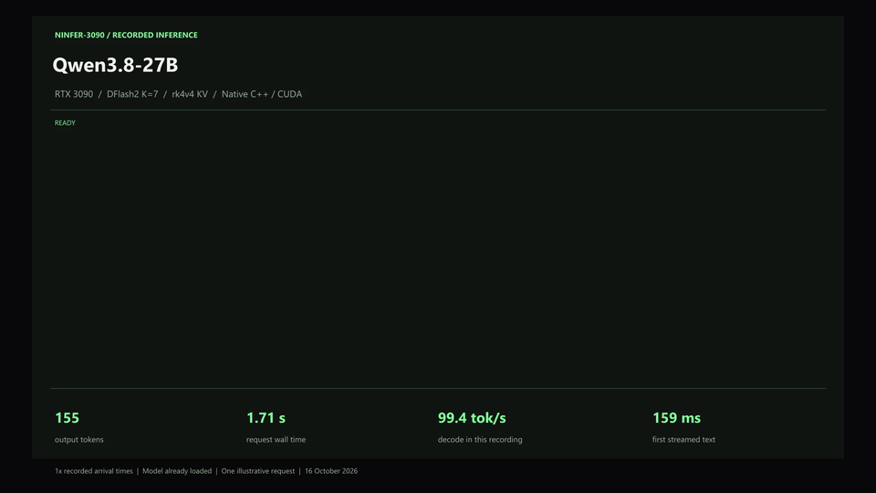

<p align="center">
  <a href="https://github.com/Don-Chad/ninfer-3090/releases/tag/v0.16.1-rtx3090">Download Windows build</a> ·
  <a href="#running-in-minutes">Quick start</a> ·
  <a href="#inference-in-action">Inference demo</a> ·
  <a href="docs/README.md">Documentation</a>
</p>

# NInfer-3090

<p>
  <a href="https://github.com/Don-Chad/ninfer-3090/releases/latest"></a>
  <a href="https://github.com/Don-Chad/ninfer-3090/actions/workflows/host-checks.yml"></a>
  <a href="#performance"></a>
  <a href="LICENSE"></a>
  <a href="https://github.com/Don-Chad/ninfer-3090/stargazers"></a>
</p>

**Hyper-optimized Qwen inference for RTX 3090.**

A native C++20/CUDA runtime with specialized **SM86 kernels**, quantized execution, CUDA Graphs,
and **ReplaySSM** state management. Supports **Qwen3.8-27B**, Qwen3.6, and
**Qwen3.8-Flash-Next as a Windows preview**. Built around the RTX 3090's compute and memory
constraints, with no Python or PyTorch runtime needed for inference.

**140 tokens/s single-stream with DFlash2 K=7 on RTX 3090.**
[Benchmark conditions](#performance).

| Capability | Specification | Conditions |
|---|---|---|
| GPU execution | Specialized Ampere SM86 kernels; CUDA Graph capture/replay | Tuned for RTX 3090; Windows and Linux builds |
| Speculative decoding | DFlash2 K=7; MTP available on compatible artifacts | Default 27B DFlash2 profile uses one lane |
| Context capacity | 188,416-token Windows DFlash2 profile; 262,144-token MTP profile | Published profile ceilings; depends on free memory and settings |
| Concurrent requests | Up to 8 configured execution lanes; compact decode batches rebuilt each round | Shared KV pool; new requests join when a lane is available |
| Memory management | Paged KV, quantized KV formats, prefix reuse, ReplaySSM | Context, state and speculation share the GPU budget |
| Output constraints | JSON Schema, GBNF, regex, choice and tool-call responses | Enforced generation constraints; tool execution stays with the client |
| APIs | OpenAI Chat Completions/Responses and Anthropic Messages | Native streaming HTTP server |
| Larger expert model | Qwen3.8-Flash-Next with expert offload | Windows preview; substantial host RAM and fast storage required |

<!-- contributor-avatars:start -->
<p>
  <a href="https://github.com/Neroued"></a>
  <a href="https://github.com/WarlaxZ"></a>
  <a href="https://github.com/ashalliants"></a>
  <a href="https://github.com/Don-Chad"></a>
  <a href="https://github.com/mgscreativa"></a>
  <a href="https://github.com/ARVLab"></a>
  <a href="https://github.com/MOVIBALE"></a>
  <a href="https://github.com/MichaelDementii"></a>
  <a href="https://github.com/ColeWheatley"></a>
  <a href="https://github.com/sry9681"></a>
  <a href="https://github.com/airtonix"></a>
  <a href="https://github.com/pinizhaninov"></a>
  <a href="https://github.com/Thireus"></a>
  <a href="https://github.com/iamwavecut"></a>
  <a href="https://github.com/adubkov"></a>
  <a href="https://github.com/justinlime"></a>
  <a href="https://github.com/kuhlsnu"></a>
</p>

Contributors: [full credits](CONTRIBUTORS.md) · [GitHub contribution history](https://github.com/Don-Chad/ninfer-3090/graphs/contributors).
<!-- contributor-avatars:end -->

## Inference in action

[](docs/assets/ninfer-demo.mp4)

**[Play the demo](docs/assets/ninfer-demo.mp4)** · Real streamed output, replayed at its recorded
arrival times. The model is already loaded when the request starts. Presentation framing is added;
the response is not sped up. [Recording details](docs/demo.md).

## Running in minutes

You need an RTX 3090/3090 Ti with 24 GB VRAM, a recent NVIDIA driver, and enough disk space for the
application and model. The recommended Qwen3.8-27B artifact is about **19 GB**. Leave GPU memory
free for the model; other GPU applications reduce the context available.

### Windows

1. Download and extract the **Windows x64 archive** from the
   [Windows release](https://github.com/Don-Chad/ninfer-3090/releases/tag/v0.16.1-rtx3090).
2. Open a terminal in that extracted folder and run:

```powershell
.\download-model.bat qwen38-27b
.\run.bat qwen38-27b
```

The launcher selects the Qwen3.8-27B profile and starts a local server. Windows also needs the
Microsoft Visual C++ 2022 runtime. [Windows archive guide](docs/release-archive-windows.md).

### Linux

Linux binaries remain available from the [ashalliants community release](https://github.com/ashalliants/ninfer-3090/releases/tag/v0.16.0-rtx3090). They are a separate build; this Windows release does not include a newly qualified Linux archive. Extract that Linux archive, open its folder, and run:

```bash
./download-model.sh qwen38-27b
./run.sh qwen38-27b
```

[Linux archive guide](docs/release-archive-linux.md). Building from a checkout instead? Use the
scripts under `scripts/`; [source-build instructions](#build-it-yourself) are below.

### Connect your client

| Client setting | Value |
|---|---|
| OpenAI-compatible base URL | `http://127.0.0.1:8080/v1` |
| Anthropic-compatible base URL | `http://127.0.0.1:8080` |
| Model | Use the model ID advertised by `GET /v1/models` |
| API key | Not required by the default local launcher |

The server binds to your own computer by default. For access from another machine, configure
authentication with `--api-key` and your network deliberately; changing the bind address alone
does not enable authentication. [Client examples and API reference](docs/serving.md).

The downloaders can also fetch an optional private graft using an existing Hugging Face login.
Set `NINFER_GRAFTS=off` to skip that extra fetch; the public model works without it.

## Supported models

| Model | Execution | Status |
|---|---|---|
| **Qwen3.8-27B** | Dense model; DFlash2 or MTP; text and vision | Recommended launcher; independently smoke-tested here |
| **Qwen3.6-35B-A3B** | MoE; MTP and compatible vision artifacts | Several configured lanes; see measured profiles |
| **Qwen3.6-27B** | Dense model | Supported artifact and launcher |
| **Qwen3.8-Flash-Next** | 512-expert MoE with host-memory expert offload | **Windows preview**; needs substantial host RAM and fast storage |
| **Ternary Bonsai 2 27B** | Ternary weight artifact | Experimental; direct CLI/server use, no launcher profile yet |

The default `qwen38-27b` launcher uses DFlash2. Other download choices are `qwen36-35b-a3b`,
`qwen36-27b`, `qwen38-flash-next`, and `bonsai2-27b`.
See [model artifacts](docs/README.md#model-artifacts) and the linked model cards before choosing.
Flash-Next uses host memory and storage for offloaded experts: it is not a model that fits wholly
inside 24 GB VRAM, and it was not part of our local smoke test.

### More context, or more simultaneous requests?

The default 27B profile selects single-stream DFlash2. The maintained launch profiles document a
Qwen3.8-27B DFlash2 ceiling of **188,416 tokens on Windows**, with a lower context selected if the
GPU is busy. An MTP profile targets the model's **262,144-token** limit with two configured lanes.
These are profile-dependent capacities, not results from our 16K-cap local smoke test.

For several clients, the engine supports **up to eight configured execution lanes** on compatible
models and settings. Lanes share the available context pool, so eight clients cannot each assume
the whole context is reserved for them. This is bounded small-scale batching; it is not a promise
of vLLM-style high-concurrency dynamic batching.

[Choose a configuration visually](docs/config-calculator.html) ·
[Profiles and memory tradeoffs](docs/maintainer/launcher-profiles.md)

## Performance

### Single-stream decode: 140 tokens/s

**Qwen3.8-27B, DFlash2 K=7, one RTX 3090.** The published benchmark uses eight thinking-off
prompts, 1,024 output tokens, greedy sampling and INT8 KV.
Benchmark contributed by [ashalliants](https://github.com/ashalliants/ninfer-3090/tree/931bd49ba332f48fad4b5230eec5a95ec5701290),
whose work is included in this engine. This is a contributor-reported measurement; throughput
varies with the workload and configuration.

### Local source build: 116.7 tokens/s, single stream

| Local qualification, 16 October 2026 | Result |
|---|---:|
| Decode speed, median | **116.7 tokens/s** |
| First streamed text, median | **127 ms** |
| Measured requests | **6**, after 3 warmups |
| Output per request | **512 tokens** |

Qwen3.8-27B, Windows, RTX 3090, CUDA 13.2/MSVC 14.43, DFlash2 K=7, one lane, 16K context cap,
`rk4v4` KV, thinking off and prefix reuse off. The fixed prompt was 52 tokens. Every measured
request produced 512 tokens; decode ranged from 116.5 to 117.4 tokens/s. Cold model startup was
about 42 seconds and is excluded from first-token latency. All six greedy outputs matched.

This is a small reproducible smoke benchmark, not a model-quality evaluation or a matched
comparison against another engine. Speed changes with the prompt, context, output and settings.
[Our method and results](docs/performance/local-qualification-20261016.md).

### More workloads

The published v0.16.0 Windows HTTP measurements report **126.3 / 125.6 / 110.2 tokens/s** after
roughly 1.3K / 8.8K / 29K prompt tokens, with DFlash2 K=7, `rk4v4` KV and its launcher settings.
Flash-Next MTP reports **112.0 / 113.2 / 103.7 tokens/s** on those prompt sizes. These are also
contributor-reported results. [Full conditions and tables](docs/performance.md#v0160-release-binaries-all-three-models-2026-10-14).

## Build it yourself

The source is C++20/CUDA. Use **CMake 3.28+**, **CUDA 12.8+**, Ninja, and the documented native
dependencies. The Windows helper selects VS 2022 Build Tools; Linux has its own build script.

```powershell
.\scripts\build.ps1
```

```bash
./scripts/build.sh
```

Use all available CPU cores for compilation. See the [Windows](docs/rtx-3090-windows.md),
[Linux](docs/rtx-3090-linux.md) and [build-system](docs/maintainer/build-system.md) guides for
toolchains and dependencies. Our qualified Windows build uses CUDA 13.2 and includes the local
compatibility fixes in this branch. Linux runtime was not independently tested in that run.

This is a native executable distribution, not a tiny single-file package: our Windows server
executable is approximately **577 MB**, plus dependency DLLs and separately downloaded weights.

## Know before you start

- Models must use the **v3 `.ninfer` container**. Existing supported v2 artifacts can be
  [upgraded without re-downloading their weights](docs/weight-conversion.md#upgrade-an-existing-v2-artifact).
- One model is loaded per server process. Capabilities such as vision and speculation are selected
  at startup; requests cannot enable a component that was not loaded.
- Tool calls are returned to your client. Your client decides whether to execute them.
- Local text inference needs no cloud service. Requesting a remote image URL intentionally
  contacts that host; optional model download and S3 storage features also use the network.
- Linux has a multi-GPU pipeline route, but distinct GPUs have not been requalified on the current
  context engine. Flash-Next is a Windows preview. Start with one supported GPU and model.
- The Windows download is this repository's v0.16.1 build, with Windows/MSVC and CUDA 13 packaging
  fixes. The Linux download is separately published by ashalliants; its validation is not ours.

[Serving reference](docs/serving.md) · [CLI](docs/cli.md) ·
[Performance](docs/performance.md) · [All documentation](docs/README.md)

## Built by a community

NInfer-3090 started as **Don-Chad's RTX 3090 adaptation** of
[Neroued's original NInfer engine](https://github.com/Neroued/ninfer).
This update brings back the substantial continued work in
[ashalliants/ninfer-3090](https://github.com/ashalliants/ninfer-3090), including major contributions
from **ashalliants**, **WarlaxZ**, **Neroued**, and others. **mgscreativa** proposed bringing that
work back through [PR #30](https://github.com/Don-Chad/ninfer-3090/pull/30) and contributed fixes.

The Flash-Next implementation also adapts work from
[wallawalla47's Infernix](https://github.com/wallawalla47/infernix); attribution is retained in the
source files. Original history, license notices and the [contributor list](CONTRIBUTORS.md)
remain part of the project. Thank you to everyone who made the 3090 implementation better.

Found a problem or have a measured improvement? Read the [contribution policy](PR_POLICY.md).
This is a community project maintained on a best-effort basis.

## License

Code: [Apache-2.0](LICENSE). Model artifacts and bundled dependencies retain their own licenses;
see their model cards and notices.
